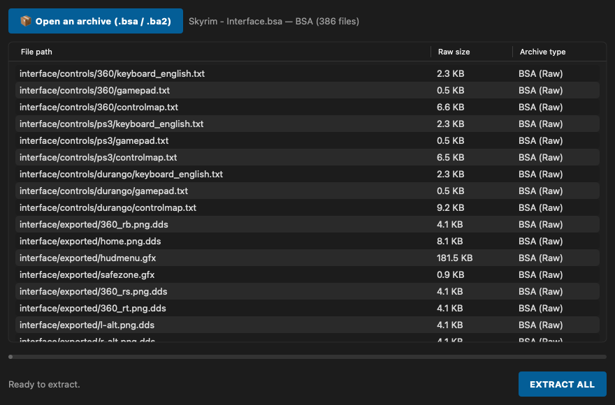

# mBAE

**Bethesda Archive Extractor: open and extract .bsa and .ba2 archives on macOS.**  
*Bethesda Archive Extractor : ouvrir et extraire les archives .bsa et .ba2 sur macOS.*

🇬🇧 [English](#-english) · 🇫🇷 [Français](#-français)

💬 **Support & community:** [Discord](https://discord.gg/xdDVDPQsYs) · *Aide et communauté : [Discord](https://discord.gg/xdDVDPQsYs)*

### About

mBAE lists and extracts Bethesda archives (.bsa / .ba2: Skyrim, Fallout 4, Starfield). By Starbudweiser & Claude Code (Anthropic). MIT License, © 2026 Starbudweiser. Provided as is, without warranty of any kind. See **About mBAE** in the app menu.

---
## 🇬🇧 English

### What it does

mBAE lists the content of Bethesda archives (Skyrim .bsa, Fallout 4 / Starfield .ba2) and extracts them to a folder of your choice, handling zlib and LZ4 compression.

### Features

- Reads **BSA** (Skyrim SE) and **BA2** archives.
- File list with path, size and compression; sortable columns.
- **Extract all** to a destination folder, with progress bar; folder structure preserved.
- Drag and drop an archive anywhere on the window.
- Interface in **English, French, Italian and Spanish** (follows your Mac's language; can be changed in the app).

### What's new in 1.3.1

- Rewritten as a native Swift app (no more Python/PyInstaller): same archives, same extracted files. No more generic PyInstaller launcher, which antivirus scanners tend to flag.
- Safer extraction: files with an absolute path or “..” in their internal path are skipped instead of being written outside the destination folder.
- Language menu in the menu bar, “About” window, automatic update check.
- The window title is translated.

### What's new in 1.3.0

- BAE is renamed mBAE, like the other Skyrim Mac Toolkit apps. Because of the new name, macOS treats it as a new app: remove the old BAE.app from Applications.
- Signed with a Developer ID and notarized by Apple: macOS now opens the app without a security warning.
- The app's launcher is now compiled from source when the app is built, instead of using PyInstaller's generic prebuilt launcher, which antivirus scanners tend to flag. No change in features.
- The first letter of the app's name now uses the colour of its logo everywhere it appears.
- Version number aligned across the Skyrim Mac Toolkit.

### Updates

The app checks once a day whether a newer release exists on GitHub and offers to install it (signature checked), remind you later or skip that version. The full history is in [CHANGELOG.md](CHANGELOG.md).

### Screenshots


*Content of a BSA archive*

### Requirements

A Mac with **Apple Silicon** (M1 or later), **macOS 15 Sequoia** or later. No Python, no Wine, no virtual machine needed.

### Installation

1. Download the zip from Nexus Mods (or from the GitHub releases) and unzip it.
2. Move **mBAE.app** to your **Applications** folder.

### How to use

1. Drop an archive on the window or click **Open an archive**.
2. Check the content, then click **EXTRACT ALL** and choose the destination folder.

### FAQ

**Can mBAE create archives?**  
No, mBAE only reads and extracts.

### Building from source

Requires Xcode (Swift 6) on macOS 15 or later. From the repository folder:

```bash
./build_app.sh
```

### License

Released under the **MIT License**: free to use, modify and share. Part of the **Skyrim Mac Toolkit**, a set of modding tools built for Skyrim players on Mac.

---

## 🇫🇷 Français

### À quoi ça sert

mBAE liste le contenu des archives Bethesda (.bsa de Skyrim, .ba2 de Fallout 4 / Starfield) et les extrait dans le dossier de votre choix, en gérant les compressions zlib et LZ4.

### Fonctions

- Lit les archives **BSA** (Skyrim SE) et **BA2**.
- Liste des fichiers avec chemin, taille et compression ; colonnes triables.
- **Extraire tout** vers un dossier de destination, avec barre de progression ; arborescence conservée.
- Glissez-déposez une archive n'importe où sur la fenêtre.
- Interface en **français, anglais, italien et espagnol** (suit la langue du Mac ; modifiable dans l'appli).

### Nouveautés de la 1.3.1

- Réécrite en appli Swift native (plus de Python ni de PyInstaller) : mêmes archives, mêmes fichiers extraits. Plus de lanceur PyInstaller générique, souvent signalé par les antivirus.
- Extraction plus sûre : les fichiers dont le chemin interne est absolu ou contient « .. » sont ignorés au lieu d'être écrits hors du dossier de destination.
- Menu « Langue » dans la barre de menus, fenêtre « À propos », recherche automatique des mises à jour.
- Le titre de la fenêtre est traduit.

### Nouveautés de la 1.3.0

- BAE s'appelle désormais mBAE, comme les autres applis du Skyrim Mac Toolkit. Avec ce nouveau nom, macOS la considère comme une nouvelle appli : supprimez l'ancienne BAE.app du dossier Applications.
- Signée avec un certificat Developer ID et notarisée par Apple : macOS ouvre désormais l'appli sans avertissement de sécurité.
- Le lanceur de l'appli est maintenant compilé depuis les sources à la construction de l'appli, au lieu du lanceur générique précompilé de PyInstaller, souvent signalé par les antivirus. Aucun changement de fonctionnalités.
- La première lettre du nom de l'appli prend la couleur de son logo partout où il est écrit.
- Numéro de version commun à tout le Skyrim Mac Toolkit.

### Mises à jour

L'appli vérifie une fois par jour si une version plus récente existe sur GitHub et propose de l'installer (signature vérifiée), de rappeler plus tard ou d'ignorer cette version. L'historique complet est dans [CHANGELOG.md](CHANGELOG.md).

### Captures d'écran


*Contenu d'une archive BSA*

### Configuration requise

Un Mac **Apple Silicon** (M1 ou plus récent), **macOS 15 Sequoia** ou plus récent. Ni Python, ni Wine, ni machine virtuelle.

### Installation

1. Téléchargez le zip sur Nexus Mods (ou dans les releases GitHub) et décompressez-le.
2. Placez **mBAE.app** dans votre dossier **Applications**.

### Utilisation

1. Déposez une archive sur la fenêtre ou cliquez sur **Ouvrir une archive**.
2. Vérifiez le contenu, puis cliquez sur **EXTRAIRE TOUT** et choisissez le dossier de destination.

### Questions fréquentes

**mBAE peut-il créer des archives ?**  
Non, mBAE lit et extrait uniquement.

### Compiler depuis les sources

Nécessite Xcode (Swift 6) sous macOS 15 ou plus récent. Depuis le dossier du dépôt :

```bash
./build_app.sh
```

### Licence

Publié sous **licence MIT** : libre d'utilisation, de modification et de partage. Fait partie du **Skyrim Mac Toolkit**, un ensemble d'outils de modding pensés pour les joueurs de Skyrim sur Mac.
